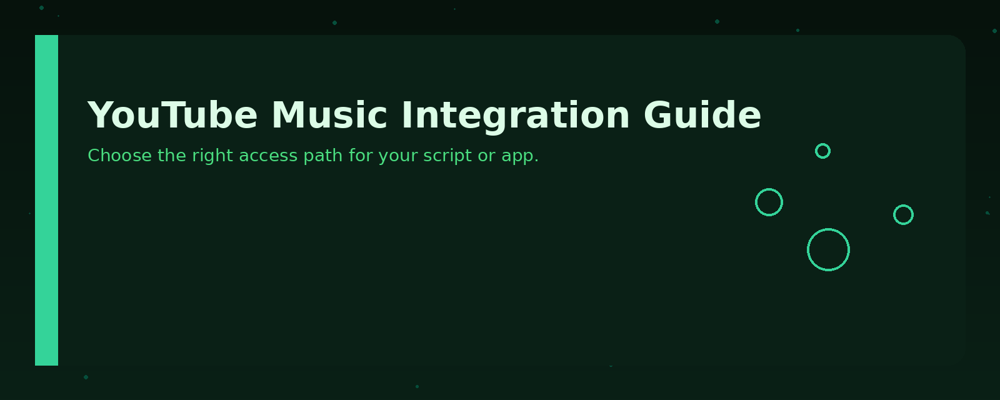
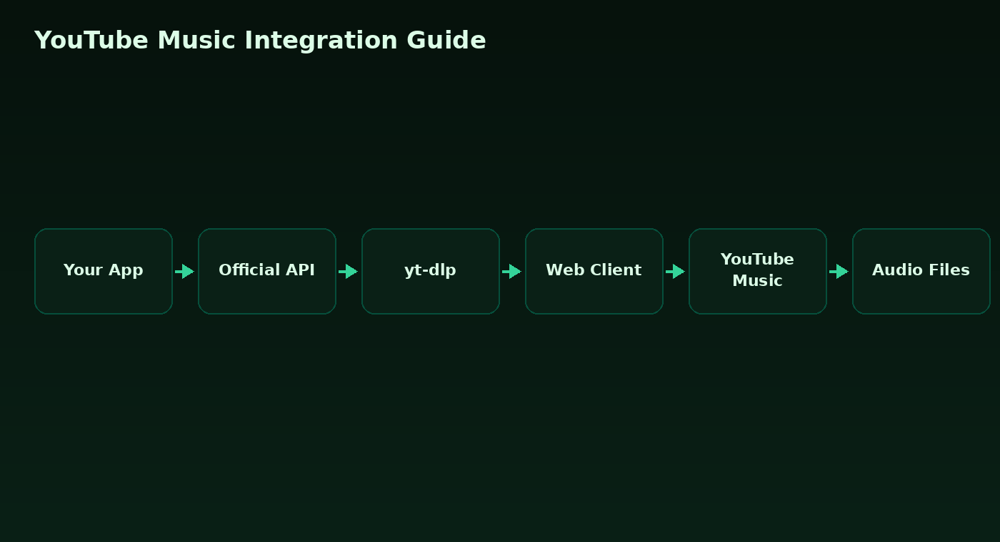

# Should You Use YouTube Music for Your Next Audio Workflow?



## When This Applies

You are building a personal project, automation script, or small integration that needs to interact with YouTube Music — for example, fetching metadata, building playlists, or analyzing listening habits. You have a Google account and are comfortable with API keys and OAuth tokens. You want a practical, no-frills guide to get started without wading through marketing pages.

## When It Does Not

Skip this guide if you are building a commercial streaming product, need offline playback, or expect full catalog parity with other music services. Also skip it if you are looking for a jailbreak or DRM-circumvention tool — that is outside the scope of this documentation and against the platform's terms.

## Comparison



| Option | What You Get | Best For |
|--------|--------------|----------|
| YouTube Music API (official) | Metadata, playlists, uploads, search | Apps that need stable, documented endpoints |
| yt-dlp with YouTube Music extraction | Full track downloads, metadata, thumbnails | Scripts that need audio files or deep metadata |
| Scraping the web client | Real-time UI data, no API key | Prototypes and personal experiments |

## Decision Tree

- Do you need to distribute the app to others?
  - Yes → use the official API (terms of service require it).
  - No → ask if you need audio files.
    - Yes → use yt-dlp.
    - No → scraping the web client is acceptable for personal use.

- Do you need playlist management?
  - Yes → official API or web client both work.
  - No → yt-dlp is enough.

- Do you need to handle uploads (your own music)?
  - Yes → official API only.
  - No → any option works.

## Anti-Patterns

- **Hardcoding OAuth tokens** in source code. Rotate them and store them in environment variables.
- **Polling the web client too aggressively**. Rate limits apply even without an API key.
- **Assuming all tracks are available**. Regional licensing means some songs are missing or replaced.
- **Mixing yt-dlp output with official API IDs**. The two use different ID schemes; keep them separate.

## Implementation Notes

Below is a minimal example that fetches the title and artist of a track using the official API. It assumes you have already set up a Google Cloud project and enabled the YouTube Data API v3.

```python
import os
import googleapiclient.discovery

API_KEY = os.environ["YOUTUBE_API_KEY"]
youtube = googleapiclient.discovery.build("youtube", "v3", developerKey=API_KEY)

# The videoId is the same ID used on youtube.com/watch?v=...
video_id = "dQw4w9WgXcQ"
request = youtube.videos().list(part="snippet", id=video_id)
response = request.execute()

item = response["items"][0]
title = item["snippet"]["title"]
channel = item["snippet"]["channelTitle"]
print(f"{title} — {channel}")
```

For a quick playlist dump without an API key, `yt-dlp` is more direct:

```bash
yt-dlp --flat-playlist --print "%(title)s | %(channel)s" \
  "https://music.youtube.com/playlist?list=PL..."
```

Remember: the official API returns metadata, not audio streams. If you need the actual audio files, `yt-dlp` is the tool to use.

## License

MIT — see the [LICENSE](LICENSE) file in this repository for details.